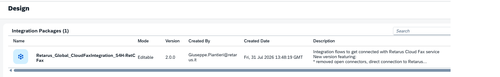
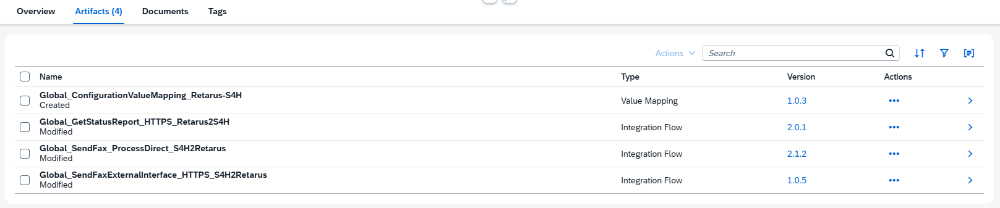
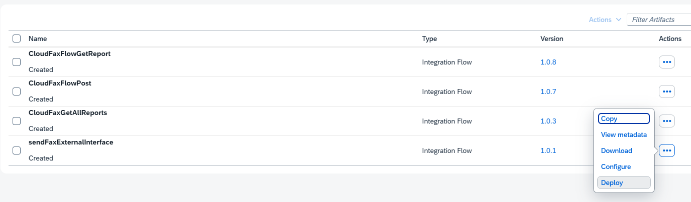
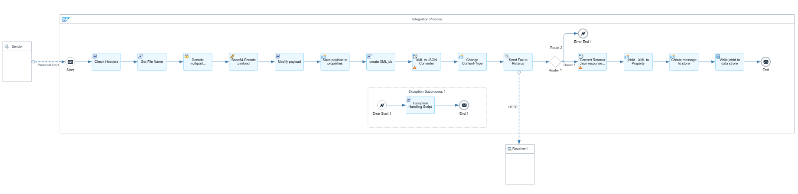
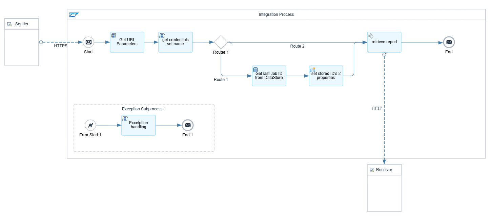
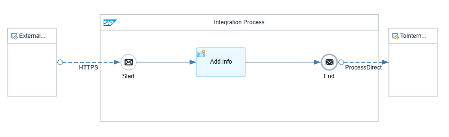

# Integration Package Description

## Summary

- [Integration Package Description](#integration-package-description)
  - [Summary](#summary)
  - [Introduction](#introduction)
  - [How to Install the package](#how-to-install-the-package)
  - [How to Use the iFlows](#how-to-use-the-iflows)
    - [Prerequisites](#prerequisites)
    - [1. SendFax](#1-sendfax)
      - [1.1. Description](#11-description)
      - [1.2. Input Connection](#12-input-connection)
      - [1.3. Input Payload](#13-input-payload)
        - [1.3.1. Content type](#131-content-type)
        - [1.3.2. Mandatory Headers](#132-mandatory-headers)
        - [1.3.3. Optional headers](#133-optional-headers)
      - [1.4. Reply](#14-reply)
    - [2. GetStatusReport](#2-getstatusreport)
      - [2.1. Description](#21-description)
      - [2.2. Input Connection](#22-input-connection)
      - [2.3. Input Payload](#23-input-payload)
      - [2.4. Reply](#24-reply)
    - [3. SendFaxExternalInterface](#3-sendfaxexternalinterface)
      - [3.1. Description](#31-description)
      - [3.2. Input Connection](#32-input-connection)
      - [3.3. Input Payload](#33-input-payload)
      - [3.4. Reply](#34-reply)
      - [3.5. Output connection](#35-output-connection)
    - [4. Setup the Global Mapping](#4-setup-the-global-mapping)
      - [4.1 Table Structure](#41-table-structure)

## Introduction

The *Retarus_Global_CloudFaxIntegration_S4H-RetCloudFax* (CloudFaxIntegration in short) package contains the following :

1. Global_SendFax_ProcessDirect_S4H2Retarus (SendFax in short)
2. Global_GetStatusReport_HTTPS_Retarus2S4H (GetStatusReport in short)
3. Global_SendFaxExternalInterface_HTTPS_S4H2Retarus (SendFaxExternalInterface in short)
4. Global_ConfigurationValueMapping_Retarus-S4H (GlobalMapping in short)

The first 3 are Integration Flows (iFlows in short) which communicate with Retarus REST API via HTTPS.
The fourth is a global mapping used for configuration.

## How to Install the package

1. Download to your PC the *.zip* file containing the full Integration package from here: *[Retarus_Global_CloudFaxIntegration_S4H-RetCloudFax_V2.0.1.zip](../../src/integration-flows/Retarus_Global_CloudFaxIntegration_S4H-RetCloudFax_V2.0.1.zip)*
2. Open your Integration Suite in SAP BTP and head to ***Design => Integration and APIs***
3. Select ***Import*** in the top right corner of the screen
4. Select the *.zip* file you just downloaded and confirm

    >If the operation has been correctly excuted, you should see something like this:
    >

5. Click on the package to enter it and select *Artifacts* in the top menu to see the aforementioned iFlows
6. If you see something like this, the package should have been correctly installed:



## How to Use the iFlows

### Prerequisites

- Before being able to use the imported iFlows, they must be deployed first:
 click on the relevant 3-dots-icon in che column *Action* and select ***Deploy***: 
    >As of version 2.0.1, the configuration is made by using the global mapping, so all iFlows can be immediately deployed.
- You need to receive the credentials from Retarus for the Fax REST API to prepare a credential set in the Integration Suite and specify it in the Global Mapping (see par. [4. Setup the Global Mapping](#4-setup-the-global-mapping))

### 1. SendFax



#### 1.1. Description

This is the main iFlow of the package. It's meant to receive a *form-data* containing a *.pdf* or a *.tiff* file as a body and some headers, transform it into a *JSON* payload complaiant with the *Retarus Cloud Fax REST API* and send it to the Reatarus Service.

#### 1.2. Input Connection

This iFlows is meant to be used as part of bigger integrations and it cannot be directly called from a public endpoint: its input connection is a ***ProcessDirect***, the native SAP optimized connection to link iFlows.

It can be called from another iFlow by using the address ***"/postFax"*** in an output ProcessDirect connection.
>About this you can use as example the supplied *SendFaxExternalInterface* iFlow

#### 1.3. Input Payload

The payload must be have the following structure.

##### 1.3.1. Content type

The input payload must be a ***multipart/form-data*** message type so it must feature the mandatory header:

- Content-Type: multipart/form-data

while the message Body must be either a *.pdf* or *.tiff* file.

##### 1.3.2. Mandatory Headers

```js
- cuno: 12345                    //the Customer Number assigned by Retarus
- csid: faxSender                //the *Called Subscriber IDentification* of the fax
- destFaxNumber: +4912345678     //the recipient fax number
- loginidserial: 1               //the progressive number that identifies the set of credentials to use
```

##### 1.3.3. Optional headers

The Optional headers are used to select the the coverpage template between the ones stored in the Retarus account and to populate the template with the desired values.  

Retarus allows Customers to store multimple coverletter templates in *HTML* format. These templates can include custom placeholders, such as *\$\{FromName\}*, *\$\{FromCompanyName\}*, *\$\{FromFaxNumber\}* or *\$\{ToCompanyName\}*.

Placeholders can be populated when rendering the coverletter, by using the values specified in the optional headers.

To select the template, add header:

```js
- coverpage: myTemplateFileName.html
```

>Note: *If no coverpage is found, the system will automatically load the template selected as default in the Retarus system.*

To pupulate the template (be it either the default or a selected one), the optional headers must be added in the following way:

```js
- key01: *placeholder1 name*
- value01: *placeholder1 value*
- key02: *placeholder2 name*
- value02: *placeholder2 value*
```

and so on. It is possible to specify up to ***99*** placeholders.

Looking at the exaple placeholders above, we could have:

```js
- key01: FromName
- value01: John Doe
- key02: FromCompanyName
- value02: Acme Inc.
```

and so on.

The final format of the payload could be something like this (in *cURL* format):

```c
curl --location 'SAP-API-ENDPOINT' \
--header 'destFaxNumber: +49123456789' \
--header 'csid: integration tester' \
--header 'loginidserial: 1' \
--header 'key01: FromName' \
--header 'value01: John Doe ' \
--header 'key02: ToName' \
--header 'value02: Jane Doe' \
--header 'key03: SubjectTitle' \
--header 'value03: Cloud fax integration testing' \
--header 'coverpage: myTemplate.html' \
--header 'cuno: 12345' \
--header 'Authorization: ••••••' \
--form 'file=@"attachment.pdf"'
```

#### 1.4. Reply

The iFlow will return, in *JSON* format, the ID of the fax job as feedback by Retarus, if the connection has been successfull.

Otherwise, it will return an error message in a different format, based on the kind of error: errors coming from Retarus will be in JSON format, system errors due to SAP could be in different formats (such as HTML).

As of Version 2.0.1, the returned Job Id is automatically stored in in the Global Data Store for 30 days or until another Job is sent by the same Customer Number. The stored Job Id can be used by the following GetStartREport iFlow to retrieve the Job Status.

### 2. GetStatusReport



#### 2.1. Description

This iFlow connects to Retarus Cloud Fax REST API to pull a report in JSON format about the status of the sent jobs.

If no parameter is supplied with the request, it will return a report of all the jobs in waiting.

If the job ID is supplied as request parameter, the iFlow will return only the report for that specific job.

#### 2.2. Input Connection

This iFlow can be directly accessed by a public endpoint (supplied by SAP after the deployment) via a GET request.

You must always supply a parameter for the Customer Number at Retarus and a parameter for the loginIdSerial:

```groovy
{{sapBaseUrl}}/http/getReport?cuno=00000&loginIdSerial=1
```

Where ***{{sapBaseUrl}}*** is the base URI defined by SAP after deployment and can be something similar to:

```groovy
https://integration.name.eu.it-cpi000-rt.cfapps.eu00-000.hana.ondemand.com
```

This call will also work if you need to pull the report of all fax jobs.
Then, depending on what you need to do, you may add the following parameters:

- to pull a report of a specific fax job:

```groovy
{{sapBaseUrl}}/http/getReport?cuno=00000&loginIdSerial=1&jobId=F2M5Y4AV6OXDBVXUGHMMKL
```

- to pull the report of the last sent Job:
  
```groovy
{{sapBaseUrl}}/http/getReport?cuno=00000&loginIdSerial=1&useLastJobId=1
```

#### 2.3. Input Payload

No payload is necessary, being a GET request.

#### 2.4. Reply

The reply, in case of a successfull connection, will be a report in *json* format as per Retarus specifications, for instance:

```json
{
  "jobId": "FJJ66GHGX105ZZBIELVCN1",
  "recipientStatus": [
    {
      "number": "+49 89 1234567-8900",
      "properties": null,
      "status": "OK",
      "reason": "OK",
      "sentTs": "2017-08-10T13:05:09Z",
      "durationInSecs": 19,
      "sentToNumber": "00498912345678900",
      "remoteCsid": "+49/89/1234567-8900"
    }
  ],
  "pages": 1,
  "reference": {
    "customerDefinedId": "2017-08-10T13:05:09Z_customerDefinedId",
    "billingCode": "2017-08-10T13:05:09Z_billingCode",
    "billingInfo": "2017-08-10T13:05:09Z_billingInfo"
  }
}
```

For the full specifications, please refer to the [Retarus Report API](https://developers.retarus.com/fax/fax4a-api/fax-reports/getstatusreport).

### 3. SendFaxExternalInterface



#### 3.1. Description

This iFlow is used with the sole scope of providing an interface to ***SendFax*** to make it reachable from the "outer" world.

It can be used for testing puposes (with postman, for instance) or by any application which is not using iFlows that is, instead, capable of sending *multipart/form-data* via HTTPS.

The ***Add Info*** block is just adding a request property to make the ***SendFax*** that will follow aware that the request has been sent by an external connection and not through an *OpenDirect* call from another iFlow. It's meant to be used for future developments.

#### 3.2. Input Connection

Input connection is a standard HTTPS POST to an endpoint provided by SAP after the iFlow is deployed.
>Note: at the moment there is no control on the incoming request but as future development there will be a script checking that the request is a POST.

#### 3.3. Input Payload

Same as for ***SendFax***, see par. [1.3. Input Payload](#13-input-payload)

#### 3.4. Reply

Same as for ***SendFax***, see par. [1.4. Reply](#14-reply)

#### 3.5. Output connection

This iFlow also features an output ProcessDirect connection that is preconfigured to forward the payload to ***SendFax***

### 4. Setup the Global Mapping

As of Version 2.0.1, the Cloud Fax Connector has been redesigned to allow configuration changes with no more need to modify and redeploy the iFlows.

Moreover, it has been thought to allows those who are using SAP BTP and the Integration Suite as a MiddleWare for multiple integrations, to have just one deployed instance to manage and yet have multiple endusers referring to it, each with his own set of credentials at Retarus. 

This concept led to the use of Global Value Mapping to configure the iFlows.
If you have any change/addition to the configuration, you can do your changes to the Value Mapping and avoid touching the iFlows.

#### 4.1 Table Structure

The Value Mapping has been designed as a small configuration Data Base, with tables that are matching entry values to output values.

Each table is defined by 2 pairs of keys, one for input and one for output, called Agency and Identifier. To each pair of keys, you can associate a unique value.

These are the tables used for configuration:

| N. | Agency in | Identifier in | <=> | Agency out | Identifier out |
| :--: | :---------: | :-------------: | :---: | :----------: | :--------------: |
| 1 | retarus | cuno.loginIdSerial | | retarus | loginIdValue |
| 2 | retarus | loginId | | s4h | credentialSetName |
| 3 | retarus | loginId | | s4h | statusPushUrl |
| 4 | s4h | statusPushUrl | | s4h | authMethod |
| 5 | s4h | statusPushUrl | | s4h | password |
| 6 | s4h | statusPushUrl | | s4h | username |

What they do:

1. At Retarus, the username is used to univocally identify the required REST API instance when there is more than one under the same Customer Number. The Integration Suite requires to store any set of credentials to authenticate to external systems, in a separate storage and identify each set with a unique name. We can imagine to associate each set of credentials to a number (that we called loginIdSerial), to avoid using the credentials set name in the API call headers. This table, then is used to match the Customer Number + loginIdSerial to the username of the Retarus credentials.

2. The second table is used to associate the aforementioned username to the credential set name stored in the Integration Suite.

>Example: let's imagine Retarus credentials are:
>
> - username: johndoe@sap.com
> - password: Integrator123!
>
> We store them in the Integration Suite storage under the name of "RetarusCredentials".
> Then we have:
>
> - Customer Number: 00000 (assigned by Retarus)
> - loginIdSerial: 1 (assigned by the BTP manager)
>
> These data will be passed via headers from the external system that is calling our integration endpoint.
>
> Based on these prerequisites, we will need to configure table 1 as:
>
> | retarus, cuno.loginIdSerial | <=> | retarus, loginIdValue |
> | :---------------------------: | :---: | :---------------------: |
> | 00000.1 | | johndoe@sap.com |
>
> Table 2, instead will have to be setup like this:
>
> | retarus, loginId | <=> | s4h, credentialSetName |
> | :----------------: | :---: | :----------------------: |
> | johndoe@sap.com | | RetarusCredentials |
>
> This way, the external system that is calling our integration to connect to Retarus API, will be associated to the correct set of credentials to the correct instance at Retarus.
>
> If any change or addition is required, the only thing to do will be to change/add data in these tables and deploy again the Value Mapping artifact, with no need of modifying and redeploying the iFlows.

Table 3 to 6 are used in case the enduser needs to receive push notifications from Retarus. They are used to setup the endpoint, auth method and credentials to communicated to Retarus in order to be able to receive the push notifications about the Jobs status:

3. As every Fax4Application instance at Retarus can send push notifications to a different endpoint, this table is used to associate the unique login ID (username) with the required endpoint.

4. Table 4 is used to associate the endpoint from table 3 to the relevant authentication method

5. Table 5 is used to match the endpoint with a username in case of BASIC auth

6. Table 6 is used to match the endpoint with a password in case of BASIC auth

>*Note: at the moment only NO auth and BASIC auth are supported by this package. In the future, also OAuth2 will be added as the Retarus Status Push service already allows to use it as Auth Method*
